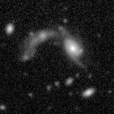

O [*Cutout Service*](https://cutout.linea.org.br) entrega recortes de imagem dos levantamentos hospedados no LIneA. O *DES* DR2 é público. Cada usuário só acessa os outros levantamentos para os quais tem direito de acesso (*data rights*).

A interface web e a API REST são formas independentes de acessar o serviço. O formulário não é usado nos exemplos de código, e os exemplos de código não dependem dele.

---

## Interface web

Abra [https://cutout.linea.org.br](https://cutout.linea.org.br). Para o *DES* DR2, o formulário fica à esquerda e o mapa *HiPS* (*Aladin Lite*) à direita.

1. Em **Survey**, selecione `DES DR2`.
2. Informe **RA (deg)** e **Dec (deg)** em graus decimais ICRS, ou centralize o mapa e use o botão de busca para preencher o centro do campo.
3. **Radius (arcmin)** é o raio em minutos de arco. O máximo é 30′.
4. Em **Format**, escolha `FITS` ou `PNG`. No PNG, **RGB color composite** monta a cor; no *DES* DR2 os presets são `gri`, `riz` e `izY`. Sem a cor composta, **Band** escolhe um filtro (`g`, `r`, `i`, `z`, `Y`).
5. Para raios de até 5′, **Download** devolve o arquivo imediatamente. Para raios maiores, o botão passa a ser **Queue job**.
6. **Add region** acumula posições e **Queue jobs** envia cada uma separadamente. Em **Bulk Coordinates**, você pode colar pares `RA Dec` ou um CSV com cabeçalho `ra,dec` e colunas opcionais `band,format,radius,color,rgb_bands`. O `radius` dessa lista também é informado em minutos de arco.
7. **Queued Jobs** acompanha o andamento e baixa os arquivos, inclusive em um arquivo ZIP.

!!! warning "A lista fica no navegador em que você abriu o Cutout Service, e o arquivo é removido do servidor após 7 dias"
    **Queued Jobs** é armazenada no navegador em que você abriu [cutout.linea.org.br](https://cutout.linea.org.br). Você pode fechar essa aba e voltar a ela. A lista não aparece em outro navegador nem em outro computador.
    O job assíncrono e o arquivo são removidos do servidor **7 dias** após a criação. Baixe o arquivo antes disso. Depois desse prazo, a lista ainda pode aparecer nesse mesmo navegador, mas o download não encontrará mais o arquivo.

Em **Survey**, depois do login, aparecem os levantamentos públicos e aqueles para os quais a conta tem direito de acesso.

---

## API REST

Os exemplos abaixo acessam

```text
https://cutout.linea.org.br
```

a partir do Jupyter. O *DES* DR2 (`ID=des_dr2`) não exige conta. Todos os recortes síncronos desta página usam raio de **0,5′**, abaixo de 1′.

| Uso | Método e caminho | Resposta |
|-----|------------------|-------------|
| Recorte imediato | `GET` ou `POST /api/sync` | O arquivo, `application/fits` ou `image/x-png` |
| Criar job | `POST /api/async` | `303 See Other`, cabeçalho `Location` e um JSON do job |
| Consultar job | `GET /api/async/{job_id}` | JSON com fase, parâmetros, tarefas e resultados |
| Fase | `GET /api/async/{job_id}/phase` | Texto puro: `QUEUED`, `EXECUTING`, `COMPLETED`, `ERROR` ou `ABORTED` |
| Interromper | `POST /api/async/{job_id}/phase` com `PHASE=ABORT` | A fase nova, em texto |
| Baixar | `GET` na `download_url` do resultado | O arquivo |

`GET /api/async` lista os jobs da conta ou, quando não há token, os jobs da sessão anônima.

No Jupyter do LIneA, `requests`, `astropy` e `matplotlib` já estão no ambiente. Fora dele: `pip install requests astropy matplotlib`.

### Token

O token identifica sua conta na API. Com ele, o serviço permite acessar os levantamentos para os quais você tem direito de acesso e recuperar um job a partir de outra máquina. O *DES* DR2 não precisa dele.

1. Entre em [https://cutout.linea.org.br](https://cutout.linea.org.br).
2. Clique no seu nome de usuário, no canto superior direito.
3. Selecione **API token**. A página também é [https://cutout.linea.org.br/users/~token/](https://cutout.linea.org.br/users/~token/).
4. Copie a chave que aparecer.

Guarde a chave na variável de ambiente `CUTOUT_TOKEN`. O valor abaixo é falso: substitua-o pela chave da sua página. **Regenerate token** invalida a chave antiga e cria outra.

```bash
export CUTOUT_TOKEN="0123456789abcdef0123456789abcdef01234567"
```

Se o notebook já estiver aberto, o `export` não ficará disponível nele. Nesse caso, defina a variável na primeira célula usando a sua chave:

```python
import os
os.environ["CUTOUT_TOKEN"] = "0123456789abcdef0123456789abcdef01234567"
```

O pedido lê essa variável e acrescenta `Token` e um espaço antes da chave. O exemplo baixa uma imagem do LSST DP1, que é um levantamento com acesso restrito. A conta precisa ter direito de acesso a ele. Para o *DES* DR2, essa autenticação não é necessária.

```python
import os
import requests
from IPython.display import Image, display

session = requests.Session()
session.headers["Authorization"] = f"Token {os.environ['CUTOUT_TOKEN']}"

response = session.get(
    "https://cutout.linea.org.br/api/sync",
    params={
        "ID": "lsst_dp1",
        "POS": "CIRCLE 53.096 -28.024 0.008333",  # 0,5 arcmin
        "BAND": "g",
        "format": "png",
    },
    timeout=60,
)
response.raise_for_status()
display(Image(data=response.content))
```

!!! warning "Mantenha sua chave segura"
Quem tiver a chave poderá usar a sua conta. Não a envie por mensagem nem deixe a chave real em um notebook que será compartilhado.

Sem token, um job criado em `/api/async` fica associado ao cookie `sessionid` enviado na resposta. As chamadas seguintes precisam reutilizar esse cookie; uma `requests.Session()` faz isso automaticamente. Um `requests.get` independente na URL do resultado responde `403`.

### Subconjunto SODA implementado pelo serviço

As requisições usam os parâmetros do [*SODA*](https://www.ivoa.net/documents/SODA/){:target="_blank"}. O ciclo de vida do job assíncrono segue o [*UWS*](https://www.ivoa.net/documents/UWS/20161024/REC-UWS-1.1-20161024.html){:target="_blank"}. Os nomes não diferenciam maiúsculas de minúsculas: `ID` e `id` são o mesmo parâmetro, assim como `POS`, `BAND` e `PHASE`.

`ID` identifica o *release*. No *DES* DR2, o valor é `des_dr2`. `BAND` identifica o filtro desse *release* (`g`, `r`, `i`, `z`, `Y`).

`POS` descreve a região em graus ICRS:

| Forma | Sintaxe | Recorte |
|-------|---------|---------|
| `CIRCLE` | `CIRCLE ra dec raio` | Recorte quadrado cujo lado mede o dobro do raio. O raio é um ângulo no céu, em graus. |
| `RANGE` | `RANGE ra_min ra_max dec_min dec_max` | Retângulo definido pelos limites de ascensão reta e declinação. |
| `POLYGON` | `POLYGON ra1 dec1 ra2 dec2 ...` | Caixa que envolve os vértices. São necessários pelo menos três vértices, fornecidos no sentido anti-horário. |

Cada pedido aceita um `ID` e um `POS`. Repetir qualquer um dos dois responde `422`.

!!! warning "`RANGE` é rejeitado pela verificação do raio"
    Atualmente, um `POS=RANGE` pequeno recebe `422` com uma mensagem informando que o raio ultrapassa 30′. A verificação lê os números da caixa na ordem errada. Por isso, os exemplos usam `CIRCLE` e `POLYGON`.

O modo síncrono aceita uma banda. O modo assíncrono pode receber mais de uma `BAND` e cria uma tarefa por filtro. Ao criar o job, `PHASE=RUN` inicia a execução. A resposta é `303`, com `Location` apontando para `/api/async/{job_id}`. O documento do job é JSON. A fase, em `/phase`, é texto puro.

Este subconjunto não implementa, de propósito:

- Documento XML do job, capabilities VOSI e um endpoint de exemplos DALI. O cliente recomendado é `requests`.
- `DESTRUCTION` e `EXECUTIONDURATION` definidos pelo cliente. O job assíncrono e o arquivo são removidos **7 dias** após a criação.
- Códigos de erro em texto puro. Os erros são retornados como JSON `{"detail": "..."}`.
- Parâmetros adicionais, fora do SODA: `format` (`fits` ou `png`), `color` e `rgb_bands`.

### Parâmetros

| Parâmetro | Obrigatório | Valor |
|-----------|-------------|-------|
| `ID` | sim | Identificador do *release*. Nos exemplos públicos, `des_dr2`. Um *release* com acesso restrito só responde se a conta tiver os direitos de acesso correspondentes. |
| `POS` | sim | `CIRCLE` ou `POLYGON`, como acima. |
| `BAND` | sim | Filtro. No *DES* DR2: `g`, `r`, `i`, `z`, `Y`. |
| `format` | não | `fits` (padrão) ou `png`. |
| `color` | não | `true` com `format=png` monta o PNG colorido a partir de `rgb_bands`. |
| `rgb_bands` | não | Três filtros, como `gri`, `g,r,i` ou `g r i`. O padrão é `gri`. |
| `PHASE` | no assíncrono | `RUN` na criação. `ABORT` interrompe um job ainda em andamento. |
| `RUNID` | não | Rótulo opaco, devolvido no campo `run_id` do job. |

O raio do `CIRCLE` é em **graus**. Um minuto de arco é `1/60` grau.

```text
0,5′ = 0,008333°
1′   = 0,016667°
5′   = 0,083333°
```

Acima de 5′ o `/api/sync` responde `422` e pede `/api/async`. O raio precisa ser menor que 30′.

### Por que alguns recortes demoram

Quatro causas cobrem quase todo cutout lento.

- **Área.** O lado cresce com o raio e o número de pixels cresce com o quadrado dele. 0,5′ é um quadrado de 228 pixels, com cerca de 0,2 MB em FITS. 5′ passa de 2 000 pixels e chega a cerca de 20 MB.
- **Mosaico.** O coadd do *DES* DR2 é dividido em uma grade de tiles. Se o campo atravessa mais de um tile, o serviço abre cada imagem e combina os dados. Tiles que não estão na mesma grade também precisam ser reprojetados.
- **Cor.** `color=true` lê três filtros. Se cada filtro cruza vários tiles, são três mosaicos antes da composição RGB.
- **Borda do *footprint*.** Fora da área coberta pelo *release*, a resposta é `422` (`No files found for band ...`). Na borda, o arquivo ainda é retornado, e os pixels sem tile têm valor zero.

Um campo de 0,5′ em um único tile é processado em cerca de 1 segundo. O mesmo centro com 6′ de raio, na banda `g`, levou cerca de 30 segundos e gerou um arquivo de 30 MB, porque o quadrado cobre vários tiles.

### Exemplos no Jupyter

A posição é RA = 41,22° e Dec = −35,56°, dentro do *DES* DR2. `display` mostra a imagem no notebook. As figuras desta página foram geradas pelas mesmas chamadas.

#### PNG de uma banda

```python
import requests
from IPython.display import Image, display

response = requests.get(
    "https://cutout.linea.org.br/api/sync",
    params={
        "ID": "des_dr2",
        "POS": "CIRCLE 41.22 -35.56 0.008333",  # 0,5 arcmin
        "BAND": "g",
        "format": "png",
    },
    timeout=60,
)
response.raise_for_status()
display(Image(data=response.content))
```

{ width="320" }

A banda `i` do mesmo campo troca só o filtro. O PNG monocromático já vem com o stretch do serviço, pronto para olhar.

```python
response = requests.get(
    "https://cutout.linea.org.br/api/sync",
    params={
        "ID": "des_dr2",
        "POS": "CIRCLE 41.22 -35.56 0.008333",
        "BAND": "i",
        "format": "png",
    },
    timeout=60,
)
response.raise_for_status()
display(Image(data=response.content))
```

{ width="320" }

#### PNG colorido

`color=true` lê `g`, `r` e `i` e produz uma imagem RGB. `BAND` continua presente na requisição.

```python
response = requests.get(
    "https://cutout.linea.org.br/api/sync",
    params={
        "ID": "des_dr2",
        "POS": "CIRCLE 41.22 -35.56 0.008333",
        "BAND": "g",
        "format": "png",
        "color": "true",
        "rgb_bands": "gri",
    },
    timeout=60,
)
response.raise_for_status()
display(Image(data=response.content))
```

{ width="320" }

`riz` é a outra composição usual. A chamada é a mesma, com `rgb_bands` trocado.

```python
response = requests.get(
    "https://cutout.linea.org.br/api/sync",
    params={
        "ID": "des_dr2",
        "POS": "CIRCLE 41.22 -35.56 0.008333",
        "BAND": "r",
        "format": "png",
        "color": "true",
        "rgb_bands": "riz",
    },
    timeout=60,
)
response.raise_for_status()
display(Image(data=response.content))
```

{ width="320" }

#### Polígono

`POLYGON` produz o recorte da caixa que contém os vértices. Os quatro cantos abaixo abrangem cerca de 0,5′ em declinação, ainda em uma chamada síncrona.

```python
response = requests.get(
    "https://cutout.linea.org.br/api/sync",
    params={
        "ID": "des_dr2",
        "POS": "POLYGON 41.216 -35.564 41.224 -35.564 41.224 -35.556 41.216 -35.556",
        "BAND": "r",
        "format": "png",
    },
    timeout=60,
)
response.raise_for_status()
display(Image(data=response.content))
```

{ width="280" }

#### FITS para medida

O FITS armazena contagens por segundo, em `float32`, sem o *stretch* aplicado ao PNG. Para visualizar as galáxias no notebook, ajuste a escala de brilho. Este arquivo tem 228×228 pixels e cerca de 0,2 MB.

```python
import requests
from io import BytesIO
import matplotlib.pyplot as plt
from astropy.io import fits
from astropy.visualization import AsinhStretch, ImageNormalize, ZScaleInterval

response = requests.get(
    "https://cutout.linea.org.br/api/sync",
    params={
        "ID": "des_dr2",
        "POS": "CIRCLE 41.22 -35.56 0.008333",  # 0,5 arcmin
        "BAND": "g",
        "format": "fits",
    },
    timeout=60,
)
response.raise_for_status()

data = fits.open(BytesIO(response.content))[0].data
norm = ImageNormalize(data, interval=ZScaleInterval(), stretch=AsinhStretch())
plt.figure(figsize=(4, 4))
plt.imshow(data, origin="lower", cmap="gray", norm=norm)
plt.title("DES DR2 g")
plt.tight_layout()
plt.show()
```

`origin="lower"` coloca o norte no topo desta imagem FITS. O PNG da banda `g`, mostrado acima, representa a mesma região do céu, já com o *stretch* aplicado pelo serviço.

#### Acima de 5′

O endpoint síncrono rejeita raios grandes. Um `CIRCLE` de 6′ em `/api/sync` devolve:

```json
{"detail":"Cutout radius 6.0 arcmin exceeds the synchronous limit of 5 arcmin. Please use POST /api/async instead. Expected processing time is 36s."}
```

O job assíncrono usa a mesma `Session` do `POST` até o download. Sem token, ela carrega o cookie. Com token, descomente o cabeçalho e o cookie deixa de ser necessário. `allow_redirects=False` preserva o `Location`. A fase é texto, não JSON.

Baixe o arquivo em até **7 dias**. Depois disso o servidor apaga o job e o resultado.

Este exemplo é deliberadamente maior: atravessa vários tiles e gera cerca de 30 MB. A visualização com `imshow` é a mesma usada para o FITS menor.

```python
import time
import requests
from io import BytesIO
import matplotlib.pyplot as plt
from astropy.io import fits
from astropy.visualization import AsinhStretch, ImageNormalize, ZScaleInterval

session = requests.Session()
# session.headers["Authorization"] = f"Token {os.environ['CUTOUT_TOKEN']}"

response = session.post(
    "https://cutout.linea.org.br/api/async",
    data={
        "ID": "des_dr2",
        "POS": "CIRCLE 41.22 -35.56 0.100000",  # 6 arcmin
        "BAND": "g",
        "format": "fits",
        "PHASE": "RUN",
    },
    allow_redirects=False,
    timeout=60,
)
response.raise_for_status()
job_url = response.headers["Location"]

phase = ""
for _ in range(40):
    phase = session.get(f"{job_url}/phase", timeout=60).text.strip()
    if phase in {"COMPLETED", "ERROR", "ABORTED"}:
        break
    time.sleep(3)
else:
    raise TimeoutError(phase)

detail = session.get(job_url, timeout=60).json()
if phase != "COMPLETED":
    message = detail["tasks"][0].get("error_message")
    raise RuntimeError(f"{phase}: {message}")

fits_response = session.get(detail["results"][0]["download_url"], timeout=300)
fits_response.raise_for_status()
data = fits.open(BytesIO(fits_response.content))[0].data

norm = ImageNormalize(data, interval=ZScaleInterval(), stretch=AsinhStretch())
plt.figure(figsize=(6, 6))
plt.imshow(data, origin="lower", cmap="gray", norm=norm)
plt.title("DES DR2 g, 6 arcmin")
plt.tight_layout()
plt.show()
```
